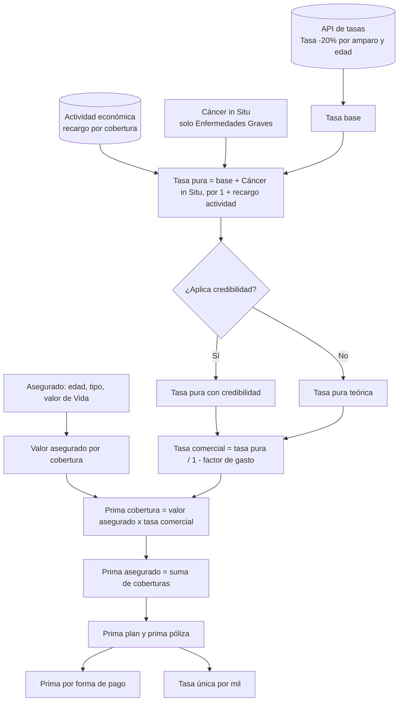

# Cálculos del Cotizador Vida Grupo

Esta carpeta documenta, paso a paso, cómo el cotizador llega desde los datos de un asegurado hasta la prima de la póliza. Todas las fórmulas corresponden al código de [`js/app.js`](../../js/app.js); cada documento indica la función que las implementa.

## Mapa de documentos

| # | Documento | Qué explica |
|---|-----------|-------------|
| 1 | [01-valor-asegurado.md](01-valor-asegurado.md) | Cómo se obtiene el valor asegurado de cada cobertura a partir del valor de Vida |
| 2 | [02-tasa-pura.md](02-tasa-pura.md) | Tasa pura: tasa de la API, extraprima de Cáncer in Situ y recargo por actividad |
| 3 | [03-recargo-comercial.md](03-recargo-comercial.md) | Factor de gasto (comisión, honorarios, IVA, gastos, utilidad) y tasa comercial |
| 4 | [04-credibilidad.md](04-credibilidad.md) | Ajuste de la tasa con la siniestralidad real de la póliza |
| 5 | [05-prima-y-forma-de-pago.md](05-prima-y-forma-de-pago.md) | Prima por cobertura, por asegurado, por plan, por póliza y fraccionamiento |
| 6 | [06-tasa-unica.md](06-tasa-unica.md) | Tasa única de la póliza y tasas por cobertura mostradas en el PDF |
| 7 | [07-ejemplo-numerico.md](07-ejemplo-numerico.md) | Ejemplo completo con cifras, de principio a fin |
| 8 | [08-parametros-y-constantes.md](08-parametros-y-constantes.md) | Tabla de constantes y reglas de negocio que alimentan los cálculos |

## Flujo general

## Convenciones

- Las **tasas** se manejan como decimales sobre el valor asegurado: `prima = valor asegurado × tasa`. Solo al presentar la tasa única se expresan **por mil**.
- Los **porcentajes** de las constantes (comisión, gastos, etc.) se escriben en puntos porcentuales (10 significa 10 %).
- Las primas se redondean a dos decimales con `Math.round(valor * 100) / 100`.
- Los códigos de cobertura son los del Core GW (por ejemplo `WET` = Vida, `WEZ` = Invalidez, `WEU`/`WEV` = Enfermedades Graves).
